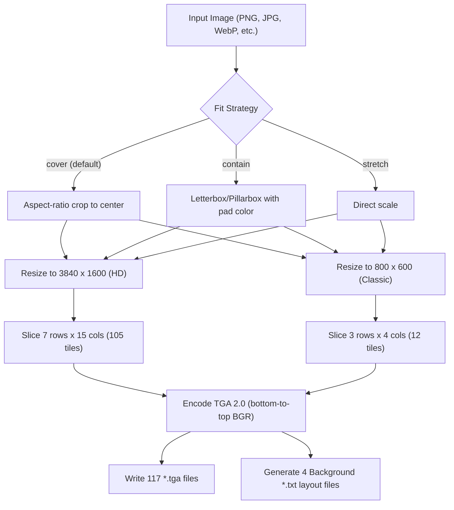

# Technical Blueprint: Half-Life Background Generator (`hl-bg`) in Rust

## 1. Executive Summary

This blueprint defines the architecture, binary specifications, crate design, and GitHub baseline for `hl-bg`: an ultra-lightweight, high-performance CLI tool and library written in **Rust**. It converts arbitrary input images (PNG, JPEG, WebP, BMP, TIFF, etc.) into the exact TGA tile slices required by the Half-Life GoldSrc engine (including the 25th Anniversary Update widescreen and 21:9 ultrawide system).

The repository is architected from day one as both:
1. A **command-line tool (`cargo install hl-bg` / standalone static executable < 3 MB)**.
2. A **reusable Rust library (`hl_bg`)** that other developers can import with `cargo add hl-bg`.

---

## 2. Reverse-Engineered Half-Life Specifications

Analysis of `C:\Program Files (x86)\Steam\steamapps\common\Half-Life\valve\resource\background` and the engine layout configuration files reveals two distinct layout tiers:

```
resource/
├── background/
│   ├── 800_1_a_loading.tga  ...  800_3_d_loading.tga   (12 files, 4:3 legacy fallback)
│   └── 21_9_1_a_loading.tga ...  21_9_7_o_loading.tga  (105 files, 21:9 ultrawide HD)
├── BackgroundLayout.txt
├── BackgroundLoadingLayout.txt
├── HD_BackgroundLayout.txt
└── HD_BackgroundLoadingLayout.txt
```

Total files per complete background set: **117 TGA files** (+ 4 optional layout definition files).

### 2.1. Layout Grid Breakdowns

#### A. HD Ultrawide Set (`21_9_*_loading.tga`)
* **Target Resolution:** `3840 x 1600` (24:10 / 21:9 ultrawide aspect ratio).
* **Grid:** 15 columns (`a` through `o`) $\times$ 7 rows (`1` through `7`) = **105 slices**.
* **Column Widths:** Columns `a` to `o` are all `256 px` ($15 \times 256 = 3840$).
* **Row Heights:**
  * Rows `1` to `6`: `256 px` ($6 \times 256 = 1536$).
  * Row `7`: `64 px` ($1536 + 64 = 1600$).
* **Tile Dimensions:**
  * Rows 1–6: `256 x 256 px`
  * Row 7: `256 x 64 px`

#### B. Classic 4:3 Fallback Set (`800_*_loading.tga`)
* **Target Resolution:** `800 x 600` (4:3 aspect ratio).
* **Grid:** 4 columns (`a`, `b`, `c`, `d`) $\times$ 3 rows (`1`, `2`, `3`) = **12 slices**.
* **Column Widths:**
  * Columns `a`, `b`, `c`: `256 px`.
  * Column `d`: `32 px` ($3 \times 256 + 32 = 800$).
* **Row Heights:**
  * Rows `1`, `2`: `256 px`.
  * Row `3`: `88 px` ($2 \times 256 + 88 = 600$).
* **Tile Dimensions:**
  * Rows 1–2, Cols a–c: `256 x 256 px`
  * Rows 1–2, Col d: `32 x 256 px`
  * Row 3, Cols a–c: `256 x 88 px`
  * Row 3, Col d: `32 x 88 px`

### 2.2. Binary TGA Specification

Every generated file must strictly obey the Truevision TGA 2.0 specification:

| Field | Size | Expected Value | Notes |
| :--- | :--- | :--- | :--- |
| **ID Length** | 1 byte | `0x00` | No image ID field |
| **Color Map Type** | 1 byte | `0x00` | No palette |
| **Image Type** | 1 byte | `0x02` | Uncompressed true-color image |
| **Color Map Spec** | 5 bytes | `0x00` $\times$ 5 | Ignored |
| **X-Origin / Y-Origin** | 4 bytes | `0x00, 0x00, 0x00, 0x00` | (0, 0) |
| **Width / Height** | 4 bytes | Little-endian `u16` | Exact tile dimensions |
| **Pixel Depth (BPP)** | 1 byte | `0x18` (24-bit) or `0x20` (32-bit) | 24-bit RGB (standard) |
| **Image Descriptor** | 1 byte | `0x00` (or `0x08` for 32-bit) | **Bit 5 must be 0** (Bottom-to-top scanlines) |
| **Pixel Data** | Variable | BGR byte order | Stored bottom row first to top row last |
| **TGA 2.0 Footer** | 26 bytes | `0x00...0x00TRUEVISION-XFILE.\0` | Extension/developer offsets = 0 |

> [!IMPORTANT]
> The GoldSrc VGUI TGA loader expects scanlines oriented **bottom-to-top** (origin at bottom-left). Top-to-bottom TGAs will appear upside down or inverted in-game.

---

## 3. Rust Technology Stack & Crate Design

### 3.1. Dependencies (Ultra-Lightweight, Pure Rust)
* **`image` (v0.25+)**: Pure Rust image decoding (PNG, JPEG, WebP, BMP, TIFF) and resizing/cropping filters (`FilterType::Lanczos3`). Zero native C dependencies.
* **`clap` (v4+, `derive` feature)**: Standard, blazing fast CLI argument parser with generated help messages, bash/zsh completions, and manpages.
* **`indicatif` (v0.17+)**: Lightweight CLI progress bar and spinner for terminal UX.
* **`thiserror` / `anyhow`**: Ergonomic and clean error propagation for both library consumers and the CLI.
* **`rayon` (optional feature flag `parallel`)**: Multi-threaded tile encoding across CPU cores for instantaneous batch processing.

### 3.2. Crate Features
* `default = ["parallel"]`
* `parallel`: Enables `rayon` for parallel slicing of all 117 tiles simultaneously.
* `cli`: Includes `clap` and `indicatif` for the binary target (`hl-bg`). Library users can disable default features or compile with `--no-default-features` for an even smaller footprint.

---

## 4. Repository Structure & GitHub Baseline

```
hl-bg/
├── .github/
│   ├── workflows/
│   │   ├── ci.yml              # cargo check, test, fmt, clippy on Windows, Ubuntu, macOS
│   │   └── release.yml         # Matrix cross-compilation & automated GitHub Release assets
│   ├── ISSUE_TEMPLATE/
│   │   ├── bug_report.md
│   │   └── feature_request.md
│   └── pull_request_template.md
├── src/
│   ├── core/
│   │   ├── mod.rs
│   │   ├── constants.rs        # Grid dimensions & coordinate tables
│   │   ├── tga.rs              # Dedicated zero-copy TGA 2.0 bottom-up encoder
│   │   ├── slicer.rs           # Scaling algorithms (cover, contain, stretch) & tile extraction
│   │   └── layout.rs           # Generation of BackgroundLayout.txt files
│   ├── cli/
│   │   ├── mod.rs
│   │   └── args.rs             # Clap CLI definition
│   ├── error.rs                # Error types
│   ├── lib.rs                  # Library entrypoint (hl_bg crate API)
│   └── main.rs                 # CLI binary entrypoint
├── tests/
│   ├── fixtures/               # Test sample images
│   ├── tga_compat_test.rs      # Byte-level comparison against official Valve TGAs
│   └── slicing_test.rs         # End-to-end integration test
├── .editorconfig
├── .gitignore
├── Cargo.toml
├── LICENSE-MIT
├── LICENSE-APACHE
├── CHANGELOG.md
└── README.md
```

---

## 5. Architecture & API Specification

### 5.1. Slicing Workflow



### 5.2. Command-Line Interface (`hl-bg`)

```bash
# Basic usage: generates all 117 TGAs and 4 layout files in ./output
hl-bg input.png -o ./valve/resource/background

# Specify scaling mode (cover, contain, stretch)
hl-bg wallpaper.jpg --fit contain --bg-color "#000000"

# Provide separate high-res widescreen and 4:3 images
hl-bg --hd widescreen.png --classic retro.png -o ./output

# Dry-run with verbose output
hl-bg sample.webp --dry-run -v
```

### 5.3. Programmatic Rust API (Library Usage)

```rust
use hl_bg::{BackgroundGenerator, FitMode, GeneratorConfig};
use std::path::PathBuf;

fn main() -> Result<(), Box<dyn std::error::Error>> {
    let config = GeneratorConfig {
        input: PathBuf::from("artwork.png"),
        output_dir: PathBuf::from("valve/resource"),
        fit: FitMode::Cover,
        include_layouts: true,
        ..Default::default()
    };

    let result = BackgroundGenerator::new(config).generate()?;
    println!("Successfully generated {} background slices!", result.slices_written);
    Ok(())
}
```
